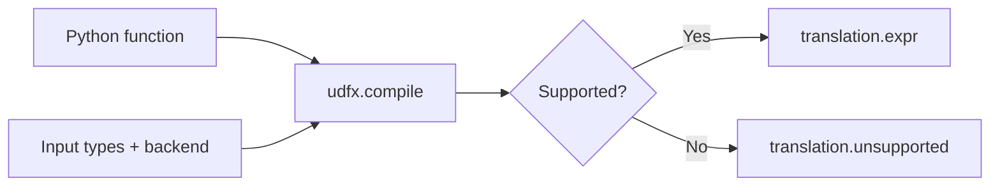
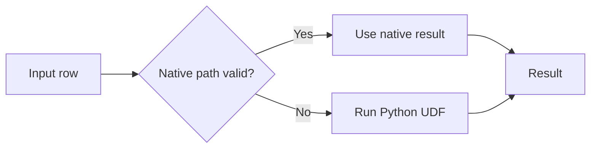

# How It Works

## Compile

Pass your function, input types, and backend to [udfx.compile](compile.md).
The compiler returns an engine expression or a reason it cannot compile the function.

Compilation does not process input rows. For example, `text.strip().lower()` becomes
string operations for your engine.

## Execute

Check `translation.ok`, then pass `translation.expr` to your dataframe query.
Your engine optimizes and executes the query.

## Fallback

Guards select native results where they preserve Python behavior.
Other rows run the original Python function.

Native errors or Python fallback can raise an exception and fail the query.

Use [udfx.explain](explain.md) to inspect native execution and fallback conditions.

Compile your first function with [Quick Start](quickstart.md).
