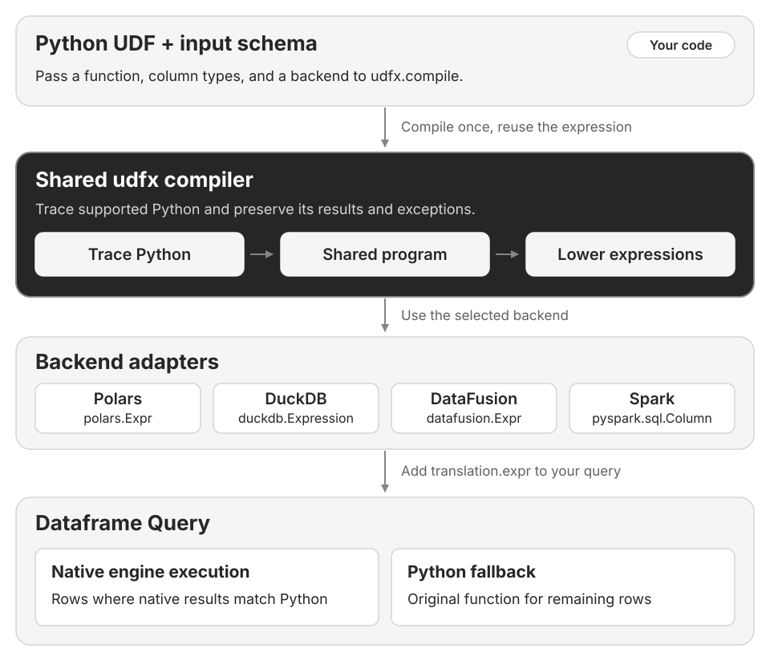

# udfx

**An optimizing compiler for Python UDFs**

Run your Python UDFs as native expressions in Polars, DuckDB, Apache DataFusion, and Apache Spark,
without any manual rewrites.

## Performance

**Overall speedups on all four engines, in both execution modes.**

Geometric mean speedups across all 25 UDFBench UDFs, including Python fallback.
Each engine's Python UDF is the 1x baseline.

Geometric mean speedups across 36 selected QURE functions, including Python fallback.

- **Memory:** prepared input.
- **Query:** Apache Parquet, with filtering and grouping where defined.

See [Benchmarking](benchmarking.md) to reproduce the measurements.

## How It Works

See [How It Works](how-it-works.md) for compilation and fallback.

## Get started

| Start here | What you will find |
| --- | --- |
| [User Guide](user-guide.md) | Install udfx and run your first function |
| [Backends](backends.md) | Examples for each engine |
| [Reference API](api.md) | Compile functions, declare types, and inspect results |
| [Contributor Guide](contributor-guide.md) | Build, test, and extend the compiler |
