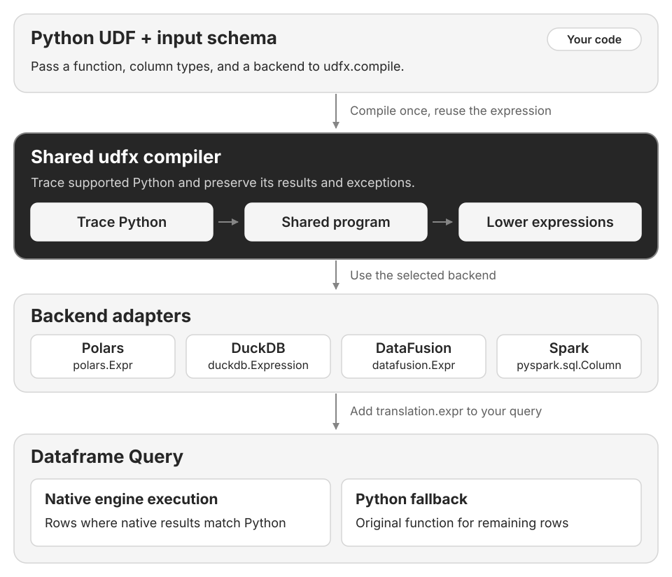

# udfx

**An optimizing compiler for Python UDFs**

Run your Python UDFs as native expressions in **Polars, DuckDB, DataFusion, and Spark**,
without rewriting your logic.

## How it works

Read [how compilation, query execution, and Python fallback work](how-it-works.md).

## Get started

| Start here | What you will find |
| --- | --- |
| [User Guide](installation.md) | Install udfx and run your first function |
| [Backends](backends.md) | Examples for each engine |
| [API Reference](api.md) | Compile functions, declare types, and inspect results |
| [Contributor Guide](contributing.md) | Build, test, and extend the compiler |

## Performance

Explore [measured speedups and trade-offs](performance.md) across all four engines.
